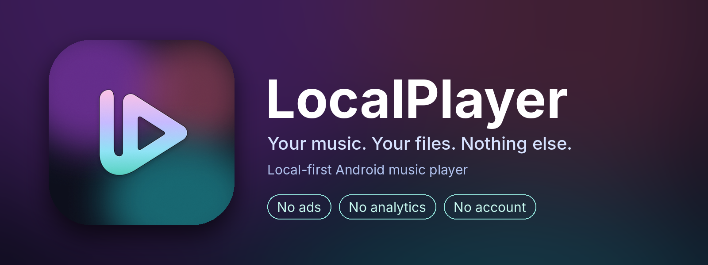
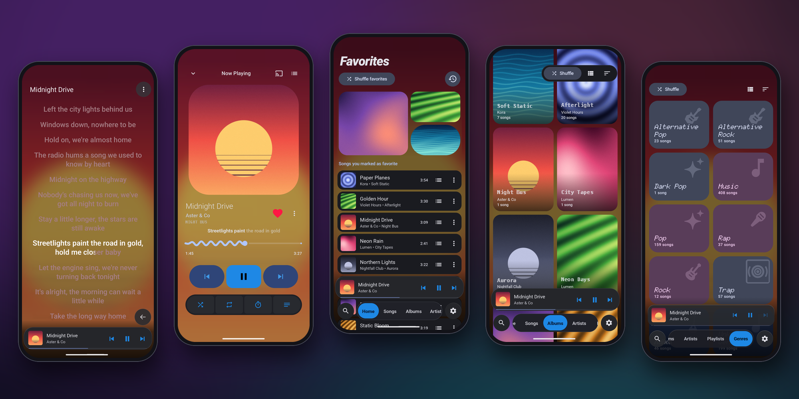
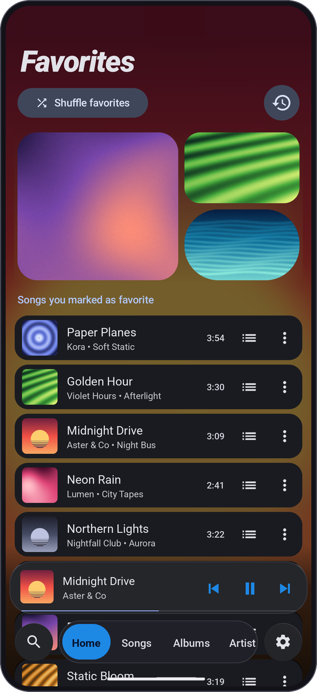
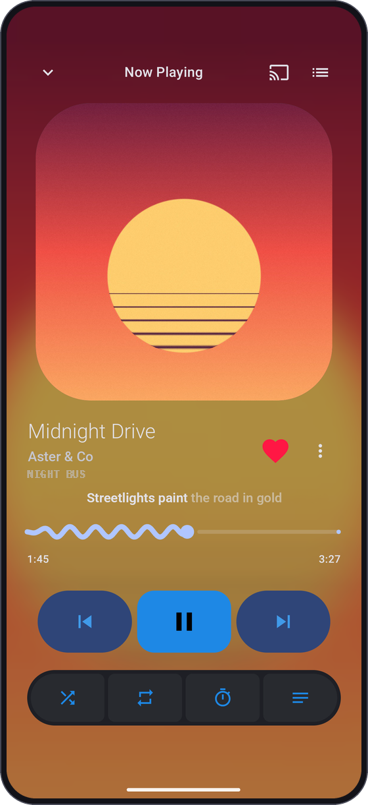
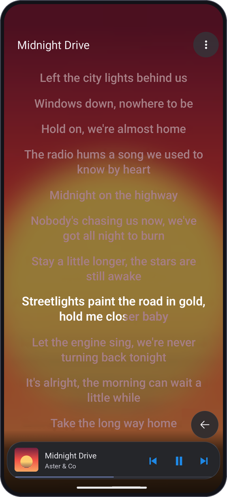
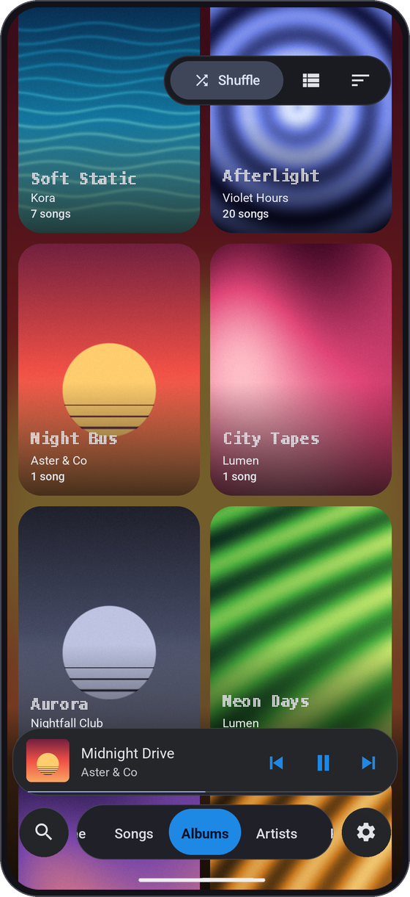
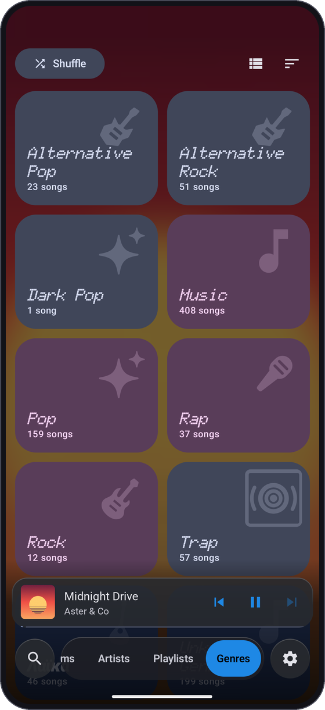
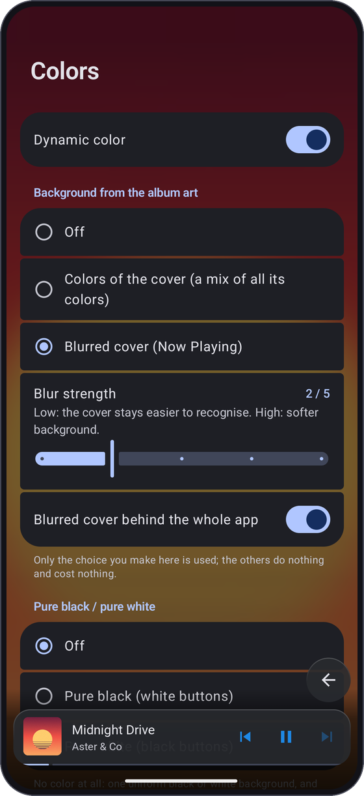
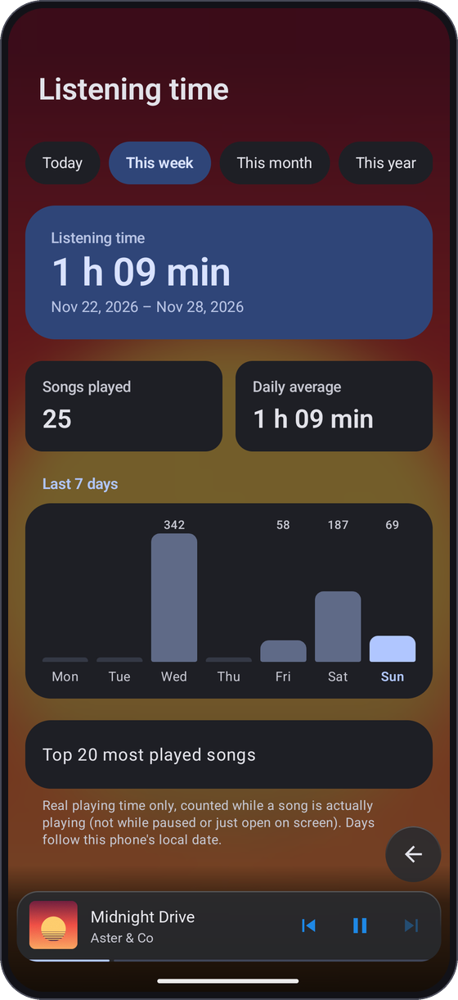

<div align="center">



# 🎧 LocalPlayer

**A local-first, audio-only music player for Android.**
No ads. No analytics. No account.

[](https://github.com/prodypro-mi2009/LocalPlayer/releases/latest)
[](https://github.com/prodypro-mi2009/LocalPlayer/releases/latest)
[](https://kotlinlang.org)
[](https://developer.android.com/jetpack/compose)
[](#-ελληνικά)

[**⬇️ Download the latest APK**](https://github.com/prodypro-mi2009/LocalPlayer/releases/latest)
[**🌐 Website**](https://prodypro-mi2009.github.io/LocalPlayer/)

</div>

---

## 📸 Screenshots

<div align="center">



| Home | Now Playing | Lyrics | Albums |
|:---:|:---:|:---:|:---:|
|  |  |  |  |

| Genres | Colors & blurred background | Statistics |
|:---:|:---:|:---:|
|  |  |  |

<sub>Demo content only: all track names, artists, lyrics and cover art in the screenshots are invented placeholders.</sub>

</div>

---

## ✨ Highlights

- 🎼 **Your library, your files** – scans MP3, FLAC, M4A and AAC; the audio file stays the source of truth
- ▶️ **Smooth player** – background playback (Media3), Now Playing sheet, queue, shuffle/repeat, swipe gestures
- 🫧 **Shuffle & History pill** – buttons that follow your finger as you scroll *(new in 2.0)*
- 🎤 **Lyrics** – plain and LRC, editor, optional LRCLIB search, shift all times, colour fill on the sung line
- 🏷️ **Tags & artwork** – edit one or many songs, "Details" page, custom covers, remove cover on save
- 📊 **Your Mix & Statistics** – Smart, Most played, Forgotten, Random; 7 / 30 / 90 / 365 days or all time
- 🎚️ **Audio** – ReplayGain (song, album or whole library) and equalizer, sleep timer with "End of the queue"
- 📥 **Downloads** – YouTube / YouTube Music via yt-dlp and FFmpeg, plus **Playlist from Spotify** *(new in 2.0)*
- 🎨 **Personalization** – themes, dynamic colors, blurred-cover backgrounds with strength slider, fonts, genre pictures
- 💾 **Backup & restore** – import by parts, optional weekly automatic backup, crash reports saved on-device only
- 🧩 **Widgets**, duplicate finder, `.m3u` import/export, folder re-link without losing favourites

> [!NOTE]
> Everything works offline. The network is used only for lyrics search, update checks and downloads you start yourself.

---

## 🚀 What's new in 2.0

- Shuffle & History **pill** (or Classic fixed row), left or right
- **Blurred cover** background by default + blur strength slider
- **Playlist from Spotify** – create or extend a playlist, then *Find the missing songs on YouTube*
- **ReplayGain** for MP3 and FLAC, **duplicate songs** finder, **batch tag editing**
- **Backup** import by parts, optional automatic weekly backup
- Faster covers at startup

Full list: [Releases](https://github.com/prodypro-mi2009/LocalPlayer/releases)

---

## 📲 Installation

1. Open the [latest release](https://github.com/prodypro-mi2009/LocalPlayer/releases/latest).
2. Download the `.apk` file.
3. Open it on your phone and allow *Install unknown apps* for your browser or file manager if asked.
4. Launch **LocalPlayer** and choose your music folders.

The built-in update check (once every 24 hours, can be turned off) tells you when a new version is out.

> [!IMPORTANT]
> YouTube downloads work on **ARM64 (arm64-v8a)** devices only. Download only content you have the right to keep.

---

## 🔒 Privacy

Local-first by design: no account, no ads, no analytics. Network access is limited to LRCLIB lyrics search, the GitHub update check and YouTube downloads. There is no Spotify login in the app.

---

## 🛠️ Built with


---

## 🧪 Build from source

Requirements: JDK 17+, Android SDK (API 36), Gradle via the included wrapper.

```bash
# Linux / macOS
./gradlew assembleDebug

# Windows (PowerShell)
.\gradlew.bat assembleDebug
```

---

<details>
<summary id="-ελληνικά"><b>🇬🇷 Ελληνικά</b></summary>

### 🎧 LocalPlayer

Ένας τοπικός (local-first) music player μόνο για ήχο, για Android. Χωρίς διαφημίσεις, χωρίς analytics, χωρίς λογαριασμό.

**Βασικά:** βιβλιοθήκη από τα δικά σας αρχεία (MP3, FLAC, M4A, AAC), στίχοι (απλοί και LRC), επεξεργασία tags και εξωφύλλων, Your Mix και στατιστικά, ReplayGain και equalizer, λήψεις από YouTube / YouTube Music, playlist από Spotify, αντίγραφα ασφαλείας, widgets, θέματα και θολό φόντο από το εξώφυλλο.

**Εγκατάσταση:** κατεβάστε το τελευταίο `.apk` από τα [Releases](https://github.com/prodypro-mi2009/LocalPlayer/releases/latest), ανοίξτε το στο κινητό και επιτρέψτε την εγκατάσταση από άγνωστες πηγές αν σας ζητηθεί.

**Απόρρητο:** το δίκτυο χρησιμοποιείται μόνο για αναζήτηση στίχων, έλεγχο ενημερώσεων και λήψεις που ξεκινάτε εσείς.

</details>
